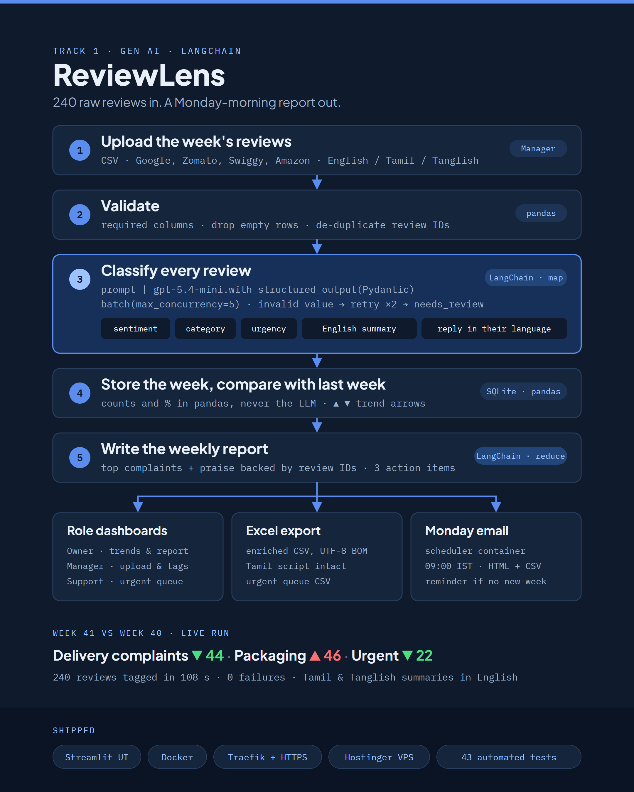

# ReviewLens - Customer Feedback Analyzer

Turn hundreds of raw customer reviews (English, Tamil, Tanglish) into tagged, prioritised insights, week-over-week trends and a weekly report that lands in the owner's inbox every Monday.

Built with **LangChain** (LCEL + structured output), **OpenAI**, **Streamlit** and **SQLite**. Brief: [`docs/USE_CASE.md`](docs/USE_CASE.md) · Plan: [`PRPs/reviewlens-prp.md`](PRPs/reviewlens-prp.md)

Live: **https://reviewlens.prasanna.digital**

<p align="center">
  
</p>

Each review gets **sentiment · category · urgency · language · English summary · reply in the customer's language (+ English version)**. Every number (counts, %, arrows) is calculated in pandas, never generated by the LLM.

## Role workspaces

| | Business Owner | Operations Manager | Customer Support |
|---|:-:|:-:|:-:|
| Weekly report, trends, overview | ✅ | ✅ | report only |
| Urgent queue | view | ✅ | ✅ |
| Upload & analyse a week, add reviews | | ✅ | |
| Edit tags (sentiment / category / urgency …) | | ✅ | |
| Edit replies, mark handled | | ✅ | ✅ |
| Regenerate report, delete week | | ✅ | |
| Send report now | ✅ | ✅ | |
| Email recipients & schedule | ✅ | | |

Roles are workspaces, not user accounts. Set `ROLE_PIN_OWNER / ROLE_PIN_MANAGER / ROLE_PIN_SUPPORT` (or `APP_PASSWORD` as a shared fallback) to require a PIN per role.

## Run locally

```bash
python -m venv .venv
.venv\Scripts\activate                 # Windows  (source .venv/bin/activate on macOS/Linux)
pip install -r requirements-dev.txt
cp .env.example .env                   # set OPENAI_API_KEY (+ SMTP_* for email)
streamlit run app.py                   # http://localhost:8501
```

On first start, three pre-analysed demo weeks (W38-W40) are loaded so trends work straight away. As **Operations Manager**, open *Manage data → Sample week → Week 41* and click **Analyse & save** to see a live analysis compared with the previous week.

## Weekly email

1. Put SMTP settings in `.env` (Gmail: `smtp.gmail.com`, `587`, `starttls` with an App Password; Hostinger mail: `smtp.hostinger.com`, `465`, `ssl`).
2. As **Business Owner**, open the *Email* tab and set recipients, day and time (default Monday 09:00 Asia/Kolkata). Use **Send report now** to test.
3. The `scheduler` container sends the latest analysed week with trend arrows and the enriched CSV attached. If that week was already sent, it sends a reminder to upload the new week instead.

Manual run: `python -m reviewlens.scheduler --once`

## Tests

```bash
pytest            # offline: fake LLM + fake SMTP, temp databases, headless UI per role
pytest -m live    # real OpenAI calls (needs .env)
ruff check .
```

## Sample data

| File | Contents |
|------|----------|
| `data/sample/reviews_week38.csv` … `reviews_week41.csv` | 210-240 synthetic reviews per week in English / Tamil / Tanglish (`python scripts/make_sample.py`) |
| `data/sample/history/2026-W38…W40.*` | the same weeks analysed by OpenAI (`python scripts/seed_history.py`); loaded when the database is empty |

Story: extra-charge complaints lead in W38 → evening delivery delays climb in W39 and peak in W40 → W41 delivery recovers, but leaking new containers make packaging complaints spike.

## Docker

```bash
docker compose up --build              # local: http://localhost:8501 (app + scheduler, data in a named volume)
```

### Production (VPS with Traefik)

```bash
git clone https://github.com/prasanna1280/ReviewLens_CustomerFeedbackAnalyzer.git /opt/apps/reviewlens
cd /opt/apps/reviewlens && cp .env.example .env   # OPENAI_API_KEY, PINs, SMTP_*, REVIEWLENS_DOMAIN
docker compose -f docker-compose.yml -f docker-compose.prod.yml up -d --build
```

Update: `git pull && docker compose -f docker-compose.yml -f docker-compose.prod.yml up -d --build` (the `reviewlens-data` volume keeps all weeks).

## Project layout

```
app.py                 Streamlit UI (role picker, tabs)
reviewlens/            schemas, prompts, chains, data/, storage, pipeline, trends, roles, emailer, scheduler, ui/
data/sample/           weekly CSVs + history/ (pre-analysed demo weeks)
scripts/               make_sample.py, seed_history.py
tests/                 pytest (offline + live)
```
